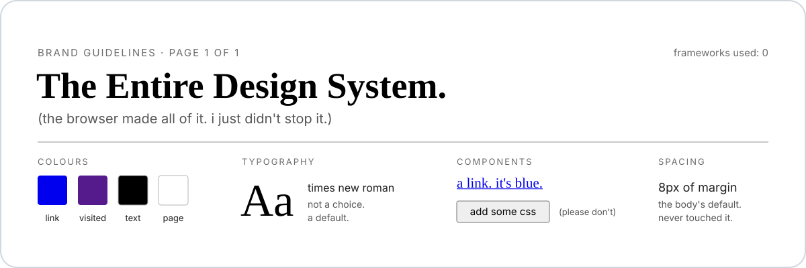

  <picture>
    <source media="(prefers-color-scheme: dark)" srcset="assets/banner-dark.svg">
    <source media="(prefers-color-scheme: light)" srcset="assets/banner-light.svg">
    
  </picture>

my personal website. nothin' fancy.

## runnin' locally

open `index.html` in browser. congratulations, you're a developer now.

## deployin'

push to `main`. github does the rest. am not explainin' ci/cd to you.

## contributin'

why would you contribute to someone's personal website? that's weird. but if you know somethin' about me that i don't know myself, check out [CONTRIBUTING.md](CONTRIBUTING.md). am genuinely curious.
